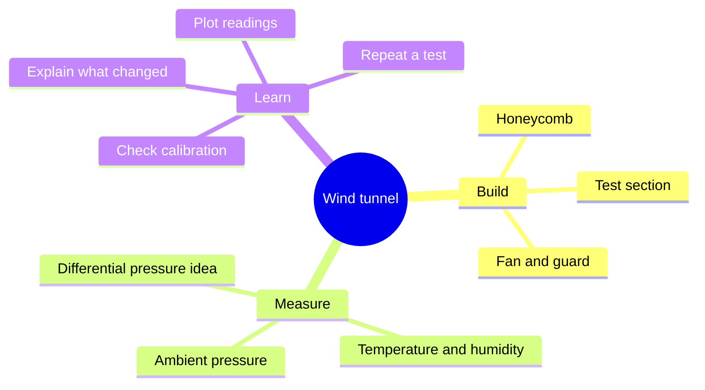

# 🌬️ Wind tunnel

[← Lab home](../README.md) · [Research & next steps](../03_research/README.md)

**Goal:** create a small, repeatable stream of air so we can observe flow and learn how to measure it.

## Build → measure → explain

**Text map:** build the passage → check sensors → repeat a test → graph readings → explain what happened.

## Explore the project

| I want to… | Open this |
| --- | --- |
| Look at printable parts | [Honeycomb and support files](design/3D_parts/) |
| Record environmental readings | [BME280 Arduino logger](code/src-arduino/BME280.V2.ino) |
| Explore a pressure-sensor simulation | [Updated logger guide](code/src-arduino/testUpdatedProgram/README.md) |
| Draw graphs from a CSV | [Python grapher guide](code/feature-csv-data-grapher/README.md) |
| See an example CSV | [Sample data — demonstration only](code/feature-csv-data-grapher/sample.csv) |
| Explore correction sliders | [Data platform](code/feature-data-correction/README.md) |

BME280 readings describe temperature, humidity, and ambient pressure; they do not directly measure lift or drag. The updated logger includes simulated differential-pressure behavior, which needs separate real-hardware validation. The correction app has preset offsets; do not treat them as a verified calibration for your sensor. Its guide describes a Flask template folder, while the committed HTML is beside the app, so its setup also needs review.

## First test idea

**Question:** how much do readings change when the fan setting changes?

1. Record the real layout, dimensions, sensor location, and fan setting.
2. Check readings with the fan off and compare with a reference instrument.
3. Repeat each fan setting using the same sensor position and recording time.
4. Keep raw readings; record any corrections separately.
5. Add a graph and two sentences explaining what changed and what is still uncertain.

Checking airflow uniformity will need a suitable airspeed measurement method at several positions. Environmental readings alone cannot prove uniform airflow.

## Add pictures as you go

A phone photo is enough: label the inlet, honeycomb, test section, and outlet. Include a ruler for scale and a caption saying what the picture shows. No photos are committed yet.

## Next build notes

- [ ] Draw the actual airflow direction and record tunnel dimensions.
- [ ] Check how the honeycomb and supports fit.
- [ ] Record the fan model, guard, and mounting.
- [ ] Add a wiring photo and reference measurements.
- [ ] Save a real test CSV and explain one graph.

Before testing, secure the model and loose parts, use a fan guard, and switch power off before adjusting the tunnel.

We will start adding more build photos, diagrams, measurements, and progress notes here.
