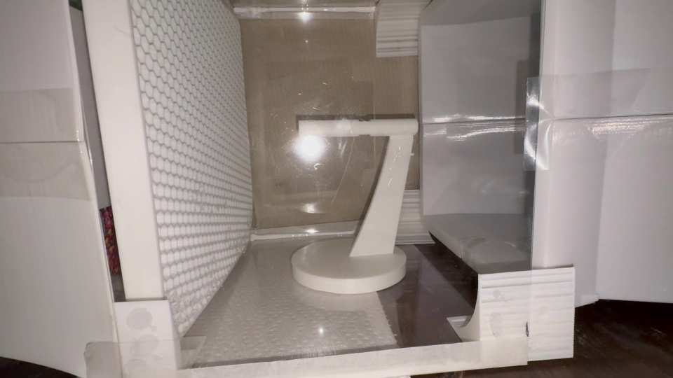
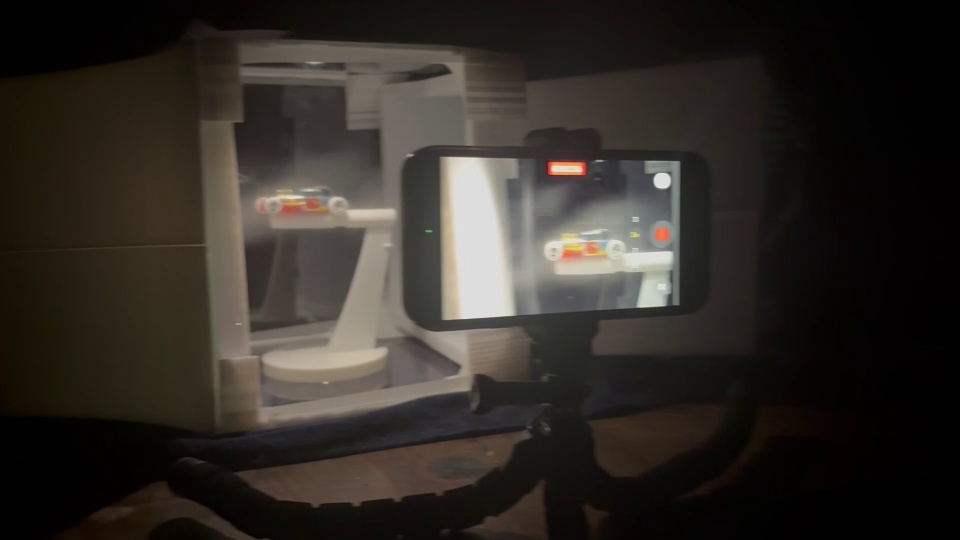
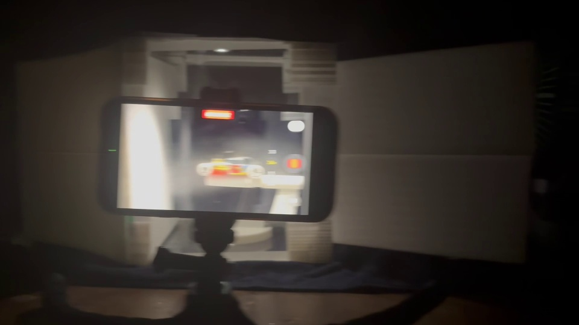
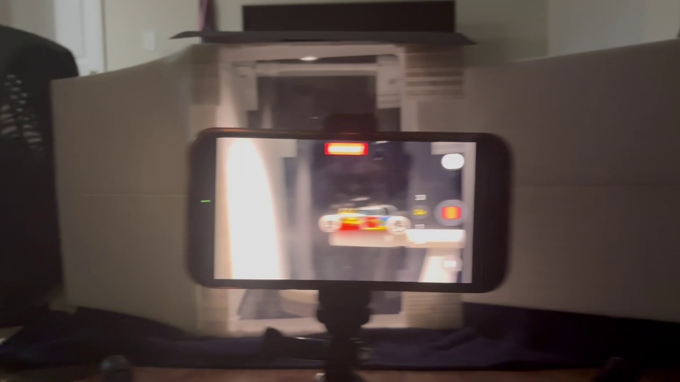
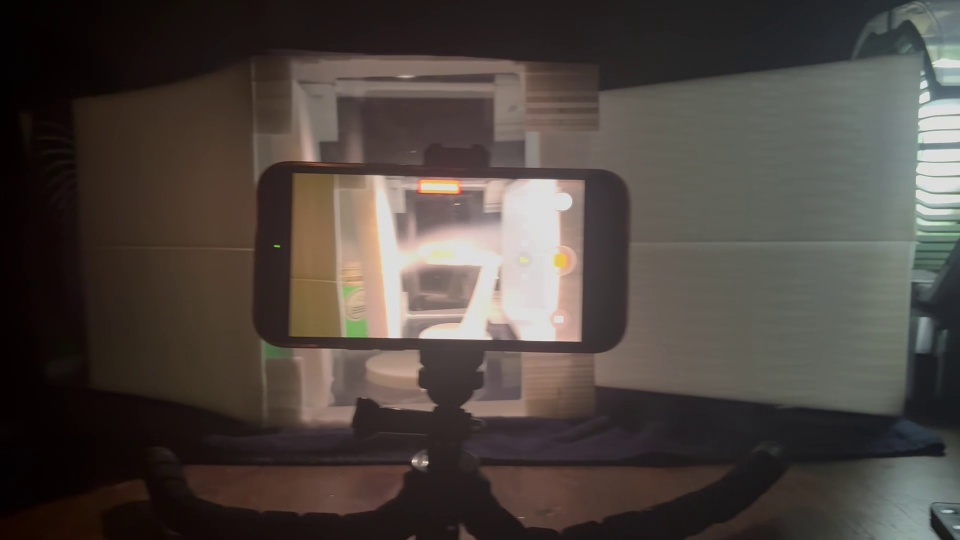
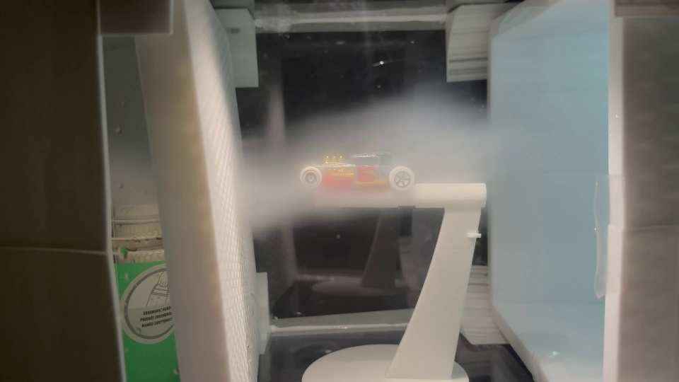

# Wind tunnel video evidence

[← Initial test record](../README.md) · [Wind tunnel project](../../README.md)

Six original supplied MOV files, preserved with their `-muted.mov` names. **Qualitative preliminary evidence — no calibrated aerodynamic measurements.** Dates, run order, fan settings, and controlled repeat conditions have not been established. Descriptions are based on sampled-frame review, as explained in the [test record](../README.md).

The JPEG previews are resized stills, not substitute evidence. Durations below are approximate media durations calculated from decoded frame count and reported average frame rate; they are not measured experiment intervals. MOV playback depends on your browser/player. Open a file and use GitHub's download option if inline playback is unavailable.

| Clip | Approx. duration | Original size | Frame dimensions |
| --- | --- | --- | --- |
| [IMG_0866](IMG_0866-muted.mov) | 111.66 s | 130,670,127 bytes | 1920 × 1080 |
| [IMG_0878](IMG_0878-muted.mov) | 4.13 s | 2,068,148 bytes | 1920 × 1080 |
| [IMG_0879](IMG_0879-muted.mov) | 3.90 s | 2,072,701 bytes | 1920 × 1080 |
| [IMG_0880](IMG_0880-muted.mov) | 3.44 s | 2,873,785 bytes | 1920 × 1080 |
| [IMG_0894](IMG_0894-muted.mov) | 3.87 s | 2,502,717 bytes | 1920 × 1080 |
| [IMG_0819](IMG_0819-muted.mov) | 151.83 s | 88,454,745 bytes | 3840 × 2160 |

## IMG_0866

Test-section assembly and white support on a round base; a perforated panel is visible. This is build context, not proof of airflow performance.



Preview near 55.83 s. [Open original MOV](IMG_0866-muted.mov).

## IMG_0878

Model car on its support and a phone on a tripod filming the test section in dim lighting.



Preview near 2.07 s. [Open original MOV](IMG_0878-muted.mov).

## IMG_0879

Another moving view of the model car, tunnel enclosure, and phone recording setup. Conditions are not documented as a separate controlled trial.



Preview near 1.95 s. [Open original MOV](IMG_0879-muted.mov).

## IMG_0880

Wider, brighter view of the model car, enclosure, recording phone, and external fans. Fan settings and airflow direction are not established.



Preview near 1.72 s. [Open original MOV](IMG_0880-muted.mov).

## IMG_0894

Dimly lit view of the model and phone recording setup; the camera pans across the enclosure. No quantitative sensor result is readable in the reviewed frames.



Preview near 1.93 s. [Open original MOV](IMG_0894-muted.mov).

## IMG_0819

Fog initially obscures much of the section; later sampled frames show a localized horizontal band near the support and reveal the model car. This is qualitative visualization only.



Preview near 121.00 s. [Open original MOV](IMG_0819-muted.mov).

## Retrieving the originals

Video files are stored using Git LFS because IMG_0866 exceeds the regular Git file-size limit. Install Git LFS, clone the repository, and fetch the media:

```sh
git lfs install
git clone https://github.com/aeriswghs-ux/Aerodynamics-Research-Lab.git
cd Aerodynamics-Research-Lab
git lfs pull
```

While reviewing an unmerged pull request, check out its branch before `git lfs pull`. GitHub source ZIP archives may contain LFS pointers instead of video content, depending on repository settings. If a downloaded file is short text beginning `version https://git-lfs.github.com/spec/v1`, it is a pointer, not the MOV. Use Git LFS or the file page's download option to retrieve the actual media.

Verify the downloaded files against [SHA256SUMS](SHA256SUMS). From this video directory, use `sha256sum -c SHA256SUMS` where available, or compare PowerShell `Get-FileHash -Algorithm SHA256 *.mov` results to the listed hashes. [manifest.json](manifest.json) also records exact byte counts and decoded media metadata. The checksums identify the supplied muted files, not any pre-upload camera originals.
