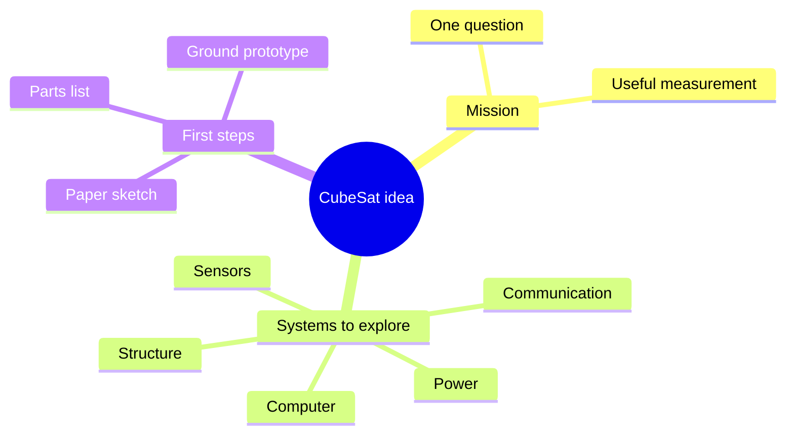

# 🛰️ CubeSat — coming up

[← Lab home](../README.md) · [Future plans](../03_research/README.md)

A CubeSat is a small satellite built around standard cube-shaped units. This project is currently a planning space: no mission, hardware, launch date, or flight results are confirmed here.

## Start with one question

What would we like to measure or demonstrate? Choose a question first, then sketch the parts needed to answer it.

**Text map:** choose a mission → sketch structure, power, computer, sensors, and communication → try a small ground prototype.

## First page of the notebook

| Decision | Current answer |
| --- | --- |
| What question are we answering? | To be decided |
| What will we measure? | To be decided |
| What can we try on the ground? | To be decided |
| What parts and budget do we need? | To be decided |
| When is the next milestone? | No date set |

## Small next steps

- [ ] Write a one-sentence mission idea.
- [ ] Draw the systems and arrows showing power and data.
- [ ] Pick one subsystem to prototype on the ground.
- [ ] Add a photo, a short test note, and what to try next.

These are planning ideas, not a commitment to build or launch a satellite.
