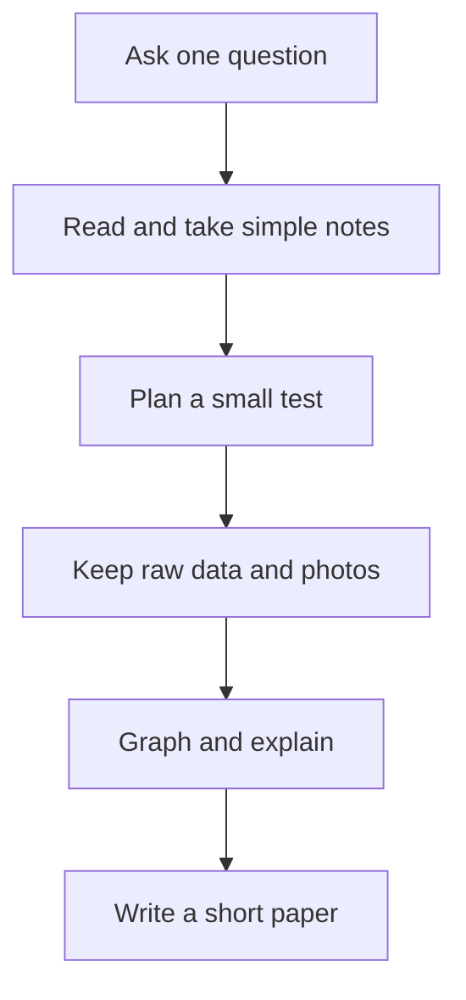

# 📚 Research papers & future plans

[← Lab home](../README.md) · [Wind tunnel](../01_wind_tunnel_design/README.md) · [CubeSat](../02_cubesat/README.md)

A place for useful reading, short explanations, and papers we may write later. We will start adding reading notes, paper drafts, and findings as the projects develop.

## From a question to a paper

**Text path:** question → reading → test → evidence → explanation → paper.

## Paper shelf

| Topic | Status | What to add next |
| --- | --- | --- |
| Wind-tunnel design and calibration | Future paper idea | Actual dimensions, build pictures, calibration method, repeated measurements |
| CubeSat mission and ground prototype | Future paper idea | Chosen mission, system sketch, prototype test |
| Reading notes | Ready for future entries | Source link, author, date, and a plain-language summary |

When a real draft exists, add its file and link it here. Keep draft, submitted, and published status separate.

## Five-sentence reading note

1. This source asks…
2. The main idea is…
3. The diagram or result I found useful is…
4. This could help our project by…
5. One thing I still do not understand is…

Include the source title, author, year, and link. Explain the idea in your own words.

## Future plans

| Next | After that | Later |
| --- | --- | --- |
| Wind tunnel: record the build and check sensors | Collect repeatable readings and a graph | Write a short design/calibration paper |
| CubeSat: choose a mission question | Draw systems and test one on the ground | Share a prototype report |

No completion dates are set. Update this table when there is actual progress.

## A simple test note

**Date · Question · Setup/photo · What I changed · Raw data file · What happened · What to try next**

