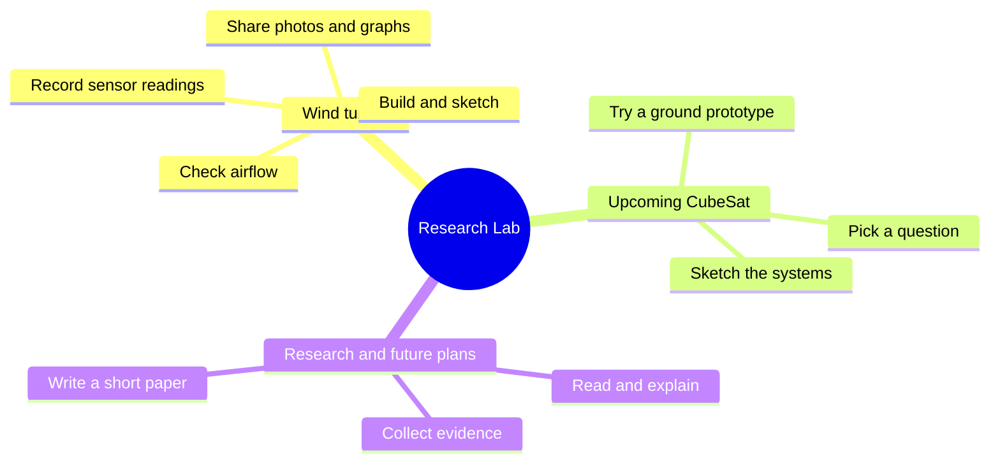
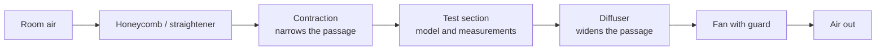

# 🌬️ Aerodynamics Research Lab

A high-school project notebook: build a wind tunnel, learn from measurements, and explore an upcoming CubeSat idea.

| Start here | What you will find | Status |
| --- | --- | --- |
| [🌬️ Wind tunnel](01_wind_tunnel_design/README.md) | Parts, sensor code, airflow ideas, and next steps | Design and code files available; physical testing still to document |
| [🛰️ CubeSat](02_cubesat/README.md) | A simple mission-planning space | Upcoming; mission and hardware undecided |
| [📚 Research papers & future plans](03_research/README.md) | Reading notes, paper ideas, and small next steps | No papers committed yet |

## The lab at a glance

**Text map:** wind tunnel → build and measure; CubeSat → plan and prototype; research → read, explain, and share evidence.

## How air could move through the tunnel

This is a **proposed suction-type layout**, not a verified drawing of the current build. Dimensions, fan position, and final assembly still need to be recorded.

**Airflow in words:** air enters → gets straighter → speeds up in a narrower passage → passes the test model → slows in a wider passage → leaves through the fan.

The honeycomb helps reduce sideways flow. The test section is where we observe the air and record measurements. [Explore the parts and measurement ideas →](01_wind_tunnel_design/README.md)

## What is actually here?

- Four [3D-print files](01_wind_tunnel_design/design/3D_parts/) for honeycomb parts and supports.
- [Arduino sensor code](01_wind_tunnel_design/code/src-arduino/) and a differential-pressure simulation.
- A [CSV graphing tool](01_wind_tunnel_design/code/feature-csv-data-grapher/README.md) with example data.
- A [data-correction app](01_wind_tunnel_design/code/feature-data-correction/README.md), preserved as an existing tool. Its setup and correction values need checking before use.

No build photos, measured tunnel-performance results, or finished research papers were found in the audited repository. Example and simulated readings are not experimental results.

## Next small steps

1. Add a labeled build photo and the real tunnel dimensions.
2. Check sensor readings against a reference, then save a short test log.
3. Pick one CubeSat question and draw a first system sketch.
4. Explain one useful paper in five sentences.

[Research ideas and paper space →](03_research/README.md)

Earlier material — preserved archive

The old README, templates, journal, and all original files are preserved in an [unchanged snapshot](archive/legacy/README.md). Earlier airfoil, drag, and drone sections are archived rather than active projects. [Archive guide and audit →](archive/README.md)

[Visit AeroAspirant](https://www.aeroaspirant.org/) · [MIT license](LICENSE)

*Structure refreshed: October 11, 2026.*
